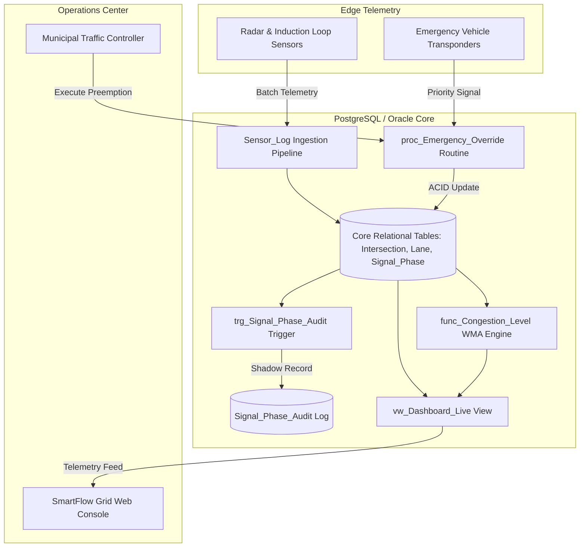

# SmartFlow Grid

[](#)
[](https://www.postgresql.org/)
[](https://www.oracle.com/database/)
[](https://nodejs.org/)
[](#)

Enterprise-grade municipal traffic monitoring, telemetry ingestion, and adaptive signal coordination platform powered by dual PostgreSQL and Oracle relational database engines with a real-time operational mission control console.

---

## Table of Contents

- [Overview](#overview)
- [Features](#features)
- [System Architecture](#system-architecture)
- [Relational Schema & Database Mechanics](#relational-schema--database-mechanics)
- [Installation & Prerequisites](#installation--prerequisites)
- [Quick Start](#quick-start)
  - [1. Database Provisioning](#1-database-provisioning)
  - [2. Operations Console (Web UI)](#2-operations-console-web-ui)
- [Directory Structure](#directory-structure)
- [Verification & Testing](#verification--testing)
- [Contributing](#contributing)
- [License](#license)

---

## Overview

**SmartFlow Grid** is a fault-tolerant municipal traffic management system designed to resolve urban gridlock through database-centric stream computation and deterministic signal orchestration. By leveraging native RDBMS capabilities—such as autonomous triggers, analytical window functions, weighted moving average (WMA) stored routines, and ACID-compliant emergency overrides—the platform achieves sub-millisecond signal arbitration without relying on brittle third-party microservice coordination.

---

## Features

- **Dual RDBMS Parity**: Production-grade schemas, seeds, analytical queries, triggers, and stored procedures implemented identically across both PostgreSQL and Oracle PL/SQL.
- **Dynamic Emergency Preemption**: Transaction-isolated stored procedures (`proc_Emergency_Override`) force immediate green corridors for emergency responders while safely staggering opposing conflict phases.
- **Weighted Moving Average (WMA) Congestion Engine**: In-engine functions (`func_Congestion_Level`) weight recent sensor telemetry (5:4:3:2:1 factor) to compute real-time level-of-service (LOS) indices (OPTIMAL, MODERATE, CONGESTED, GRIDLOCK).
- **Autonomous Shadow Audit Trail**: Zero-latency database triggers (`trg_Signal_Phase_Audit`) log immutable forensic records of state transitions, manual overrides, and phase modifications into dedicated audit tables.
- **Cross-Zone Regional Diversion**: Cursor-driven routines (`cursor_Regional_Diversion`) scan adjacent intersection topologies to compute spillover thresholds and reroute regional flow.
- **Real-Time Operations Console**: Zero-dependency Vite-powered municipal console rendering live topological lane networks, phase cycle telemetry, and live database verification metrics.

---

## System Architecture



---

## Relational Schema & Database Mechanics

The core relational domain enforces strict third normal form (3NF) and foreign-key referential integrity:

1. **`Intersection`**: Spatial node registry defining grid zones and physical coordinates.
2. **`Lane`**: Directional ingress/egress channels linked to intersections with capacity limits and designated emergency corridor flags (`Is_Emergency_Corridor`).
3. **`Signal_Phase`**: Current light state (`RED`, `YELLOW`, `GREEN`), green-split allocations (5–120s), and preemption status.
4. **`Sensor_Log`**: Time-series telemetry recording vehicle counts, queue occupancy, and speed readings.
5. **`Signal_Phase_Audit`**: Immutable event-sourcing ledger capturing timestamp, old/new states, triggering user, and transaction context.

---

## Installation & Prerequisites

### Prerequisites

- **Relational Backend**: 
  - [PostgreSQL](https://www.postgresql.org/download/) 14.0+ (16 recommended) **OR**
  - [Oracle Database](https://www.oracle.com/database/technologies/) 19c / 21c (Enterprise or XE)
- **Frontend / Runtime**: 
  - [Node.js](https://nodejs.org/) v18.0.0+
  - npm v9.0.0+

---

## Quick Start

### 1. Database Provisioning

#### Option A: PostgreSQL Deployment
```bash
# Connect to target database
psql -U postgres -d smartflow_db -f postgresql/schema/01_ddl_tables.sql
psql -U postgres -d smartflow_db -f postgresql/schema/02_ddl_audit.sql
psql -U postgres -d smartflow_db -f postgresql/triggers/01_trg_signal_phase_audit.sql
psql -U postgres -d smartflow_db -f postgresql/routines/01_proc_emergency_override.sql
psql -U postgres -d smartflow_db -f postgresql/routines/02_func_congestion_level.sql
psql -U postgres -d smartflow_db -f postgresql/routines/03_cursor_regional_diversion.sql
psql -U postgres -d smartflow_db -f postgresql/views/01_vw_dashboard_live.sql
psql -U postgres -d smartflow_db -f postgresql/seeds/01_seed_intersections_lanes.sql
psql -U postgres -d smartflow_db -f postgresql/seeds/02_seed_signal_phases.sql
psql -U postgres -d smartflow_db -f postgresql/seeds/03_seed_sensor_logs.sql
```

#### Option B: Oracle Deployment
```sql
-- Execute within SQL*Plus or SQL Developer
@oracle/schema/01_ddl_tables.sql;
@oracle/schema/02_ddl_audit.sql;
@oracle/triggers/01_trg_signal_phase_audit.sql;
@oracle/routines/01_proc_emergency_override.sql;
@oracle/routines/02_func_congestion_level.sql;
@oracle/routines/03_cursor_regional_diversion.sql;
@oracle/views/01_vw_dashboard_live.sql;
@oracle/seeds/01_seed_intersections_lanes.sql;
@oracle/seeds/02_seed_signal_phases.sql;
@oracle/seeds/03_seed_sensor_logs.sql;
```

---

### 2. Operations Console (Web UI)

Run the local operations console via automated launcher or manual installation:

#### Automated Launcher (Windows)
```cmd
run_demo.bat
```

#### Manual Startup
```bash
cd web
npm install
npm run dev
```

The web console binds to `http://localhost:3000` with live simulation feeds, interactive signal overrides, SQL drawers, and real-time congestion monitors.

---

## Directory Structure

```text
.
├── oracle/                         # Oracle PL/SQL Suite
│   ├── queries/                    # Analytical & Temporal Reporting Queries
│   ├── routines/                   # Stored Procedures, Functions & Cursors
│   ├── schema/                     # Core DDL & Audit Table Definitions
│   ├── seeds/                      # Deterministic Municipal Test Data
│   ├── tests/                      # Automated Regression Harnesses
│   ├── triggers/                   # Audit Shadow Triggers
│   └── views/                      # Live Aggregation Views
├── postgresql/                     # PostgreSQL Suite
│   ├── queries/                    # Standard SQL-Compliant Analytical Queries
│   ├── routines/                   # PL/pgSQL Stored Procedures & Functions
│   ├── schema/                     # DDL Definitions & Constraints
│   ├── seeds/                      # Benchmark Seed Data
│   ├── tests/                      # psql Automated Test Scripts
│   ├── triggers/                   # PL/pgSQL Trigger Definitions
│   └── views/                      # Materialized & Relational Views
├── web/                            # Municipal Operations Console Frontend
│   ├── src/                        # Simulator Engine, Visualizers, and Dashboard
│   ├── index.html                  # Console Root Shell
│   ├── package.json                # Project Dependencies
│   └── vite.config.js              # Vite Bundler Configuration
├── run_demo.bat                    # Production Demo Batch Launcher
├── run_gui.bat                     # Direct Console Dev Server Launcher
└── .gitignore                      # Version Control Exclusions
```

---

## Verification & Testing

Verify end-to-end relational schema integrity and routine execution:

### PostgreSQL Test Harness
```bash
psql -U postgres -d smartflow_db -f postgresql/tests/run_all_postgres.sql
```

### Oracle Test Harness
```sql
@oracle/tests/run_all_oracle.sql;
```

### Core Analytical Invariants Checked:
1. **Capacity Bounds**: Validates `CHECK (Capacity_Limit > 0)`.
2. **Phase Exclusivity**: Enforces that conflicting intersection phases cannot simultaneously report green states.
3. **Audit Immutability**: Proves that phase updates generate persistent records in `Signal_Phase_Audit` with timestamp and user ID.
4. **WMA Mathematical Accuracy**: Confirms that 5-step rolling sensor logs yield valid categorical outputs (`OPTIMAL`, `MODERATE`, `CONGESTED`, `GRIDLOCK`).

---

## Contributing

We welcome production-grade contributions, database optimizations, and telemetry adapters.

### Contribution Rules
1. **Engine Parity**: Every DDL or procedural modification made to `postgresql/` must have an identical, behaviorally equivalent implementation in `oracle/`.
2. **Deterministic SQL**: Avoid non-deterministic ordering without explicit `ORDER BY` clauses in queries and views.
3. **Naming Conventions**:
   - Tables & Views: `PascalCase` (e.g., `Signal_Phase`, `vw_Dashboard_Live`)
   - Stored Procedures: `proc_<Action>` (e.g., `proc_Emergency_Override`)
   - Functions: `func_<Metric>` (e.g., `func_Congestion_Level`)
   - Triggers: `trg_<Target>_<Event>` (e.g., `trg_Signal_Phase_Audit`)

### Workflow
```bash
git checkout -b feat/telemetry-optimization
# Implement and test on both PostgreSQL and Oracle engines
git commit -m "feat(database): implement adaptive green-split smoothing algorithm"
git push origin feat/telemetry-optimization
```

---

## License

This project is licensed under the MIT License. See [LICENSE](LICENSE) for details.
