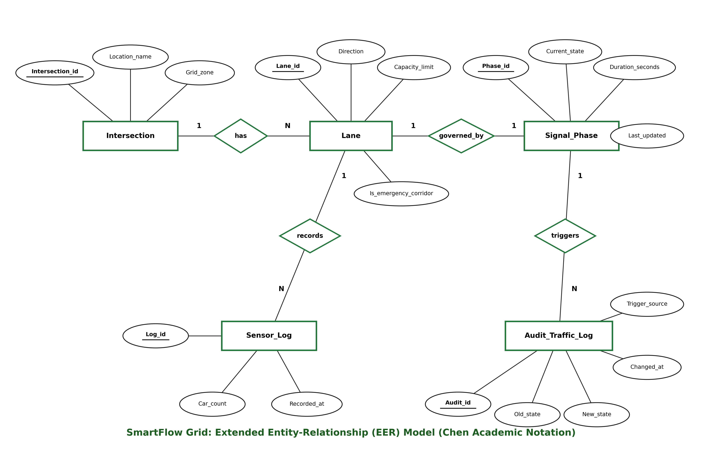

# SmartFlow Grid: Entities, Attributes & EER Specification

This document details the relational entity model and attribute dictionary. The specifications are structured modularly to allow straightforward translation into any academic EER visual standard (Chen notation, Min-Max, or Crow's Foot).

---

## 1. Entity Definitions & Attribute Dictionary

### Entity 1: `Intersection`
Represents a physical road junction within the urban road network.
- **`Intersection_ID`** (`NUMBER` / `INTEGER`): Primary Key. Unique identifier for the junction.
- **`Location_Name`** (`VARCHAR2(100)` / `VARCHAR(100)`): Descriptive name of the geographical intersection (e.g., 'Central Plaza', 'Harbor Blvd & 4th Ave'). NOT NULL, UNIQUE.
- **`Grid_Zone`** (`VARCHAR2(50)` / `VARCHAR(50)`): Urban administrative/traffic surveillance sector (e.g., 'Zone A - Downtown', 'Zone B - Uptown'). NOT NULL.

### Entity 2: `Lane`
Represents an approach lane leading into an intersection.
- **`Lane_ID`** (`NUMBER` / `INTEGER`): Primary Key. Unique identifier for the lane.
- **`Intersection_ID`** (`NUMBER` / `INTEGER`): Foreign Key referencing `Intersection(Intersection_ID)`. NOT NULL.
- **`Direction`** (`VARCHAR2(20)` / `VARCHAR(20)`): Approach heading (`'NORTHBOUND'`, `'SOUTHBOUND'`, `'EASTBOUND'`, `'WESTBOUND'`). NOT NULL.
- **`Capacity_Limit`** (`NUMBER` / `INTEGER`): Maximum vehicular queue capacity under static saturation. NOT NULL, CHECK (`Capacity_Limit > 0`).
- **`Is_Emergency_Corridor`** (`NUMBER(1)` / `SMALLINT`): Boolean flag (0 or 1). Indicates whether the lane is a designated primary emergency transit path. DEFAULT 0.

### Entity 3: `Signal_Phase`
Represents the traffic signal controller head governing vehicular movement for a specific lane.
- **`Phase_ID`** (`NUMBER` / `INTEGER`): Primary Key. Unique identifier for the signal phase.
- **`Lane_ID`** (`NUMBER` / `INTEGER`): Foreign Key referencing `Lane(Lane_ID)`. Unique 1-to-1 relationship per lane. NOT NULL.
- **`Intersection_ID`** (`NUMBER` / `INTEGER`): Foreign Key referencing `Intersection(Intersection_ID)`. NOT NULL.
- **`Current_State`** (`VARCHAR2(10)` / `VARCHAR(10)`): Operational phase color. NOT NULL, CHECK (`Current_State IN ('RED', 'YELLOW', 'GREEN')`).
- **`Duration_Seconds`** (`NUMBER` / `INTEGER`): Time duration allocated to the active state. NOT NULL, CHECK (`Duration_Seconds > 0`).
- **`Last_Updated`** (`TIMESTAMP`): Timestamp of the most recent state change. NOT NULL.

### Entity 4: `Sensor_Log`
Represents time-series telemetry recorded by IoT inductive loops or roadside cameras.
- **`Log_ID`** (`NUMBER` / `INTEGER`): Primary Key. Unique telemetry reading identifier.
- **`Lane_ID`** (`NUMBER` / `INTEGER`): Foreign Key referencing `Lane(Lane_ID)`. NOT NULL.
- **`Car_Count`** (`NUMBER` / `INTEGER`): Detected vehicular volume during sample interval. NOT NULL, DEFAULT 0, CHECK (`Car_Count >= 0`).
- **`Recorded_At`** (`TIMESTAMP`): Telemetry capture timestamp. NOT NULL, DEFAULT `CURRENT_TIMESTAMP`.

### Entity 5: `Audit_Traffic_Log`
Maintains an immutable historical record of all signal transitions triggered automatically.
- **`Audit_ID`** (`NUMBER` / `INTEGER`): Primary Key. Unique sequence/identity identifier.
- **`Phase_ID`** (`NUMBER` / `INTEGER`): Foreign Key referencing `Signal_Phase(Phase_ID)`. NOT NULL.
- **`Old_State`** (`VARCHAR2(10)` / `VARCHAR(10)`): Previous signal state prior to actuation.
- **`New_State`** (`VARCHAR2(10)` / `VARCHAR(10)`): New signal state after actuation.
- **`Changed_At`** (`TIMESTAMP`): Timestamp when transition occurred. NOT NULL.
- **`Trigger_Source`** (`VARCHAR2(50)` / `VARCHAR(50)`): Event context (e.g., 'SYSTEM_TIMER', 'EMERGENCY_OVERRIDE').

---

## 2. Cardinalities & Relational Relationships

| Entity A | Relationship | Entity B | Cardinality (A : B) | Foreign Key Location | Delete Rule |
| :--- | :--- | :--- | :--- | :--- | :--- |
| **Intersection** | Has | **Lane** | $1 : N$ (One-to-Many) | `Lane.Intersection_ID` | `ON DELETE CASCADE` |
| **Lane** | Governed By | **Signal_Phase** | $1 : 1$ (One-to-One) | `Signal_Phase.Lane_ID` | `ON DELETE CASCADE` |
| **Lane** | Records | **Sensor_Log** | $1 : N$ (One-to-Many) | `Sensor_Log.Lane_ID` | `ON DELETE CASCADE` |
---

## 2. Extended Entity-Relationship (EER) Model (Chen Notation)

The visual EER diagram follows standard academic **Chen notation** as required for institutional evaluation:
- **Entities** are represented by **green bordered rectangles**.
- **Attributes** are represented by **ellipses**, connected to their respective entities. Primary keys are explicitly **underlined**.
- **Relationships** are represented by **green bordered diamonds** with cardinalities ($1 : 1$, $1 : N$) clearly labeled along connector edges.

### Structural Relationships & Multiplicities:
1. **`Intersection` $\stackrel{1}{\longleftrightarrow}$ `has` $\stackrel{N}{\longleftrightarrow}$ `Lane`**: One intersection oversees multiple approach lanes ($1:N$).
2. **`Lane` $\stackrel{1}{\longleftrightarrow}$ `governed_by` $\stackrel{1}{\longleftrightarrow}$ `Signal_Phase`**: Each directional lane is independently regulated by a dedicated signal phase ($1:1$).
3. **`Lane` $\stackrel{1}{\longleftrightarrow}$ `records` $\stackrel{N}{\longleftrightarrow}$ `Sensor_Log`**: Each physical lane accumulates ongoing time-series vehicle count telemetry ($1:N$).
4. **`Signal_Phase` $\stackrel{1}{\longleftrightarrow}$ `triggers` $\stackrel{N}{\longleftrightarrow}$ `Audit_Traffic_Log`**: State transitions generate immutable audit trail entries ($1:N$).

---

## 3. Schema Notation

$$\text{Intersection}(\underline{\text{Intersection\_ID}}, \text{Location\_Name}, \text{Grid\_Zone})$$

$$\text{Lane}(\underline{\text{Lane\_ID}}, \text{Direction}, \text{Capacity\_Limit}, \text{Is\_Emergency\_Corridor}, \text{Intersection\_ID}^*)$$

$$\text{Signal\_Phase}(\underline{\text{Phase\_ID}}, \text{Current\_State}, \text{Duration\_Seconds}, \text{Last\_Updated}, \text{Lane\_ID}^*, \text{Intersection\_ID}^*)$$

$$\text{Sensor\_Log}(\underline{\text{Log\_ID}}, \text{Car\_Count}, \text{Recorded\_At}, \text{Lane\_ID}^*)$$

$$\text{Audit\_Traffic\_Log}(\underline{\text{Audit\_ID}}, \text{Old\_State}, \text{New\_State}, \text{Changed\_At}, \text{Trigger\_Source}, \text{Phase\_ID}^*)$$

*(Asterisk $^*$ denotes Foreign Key)*
